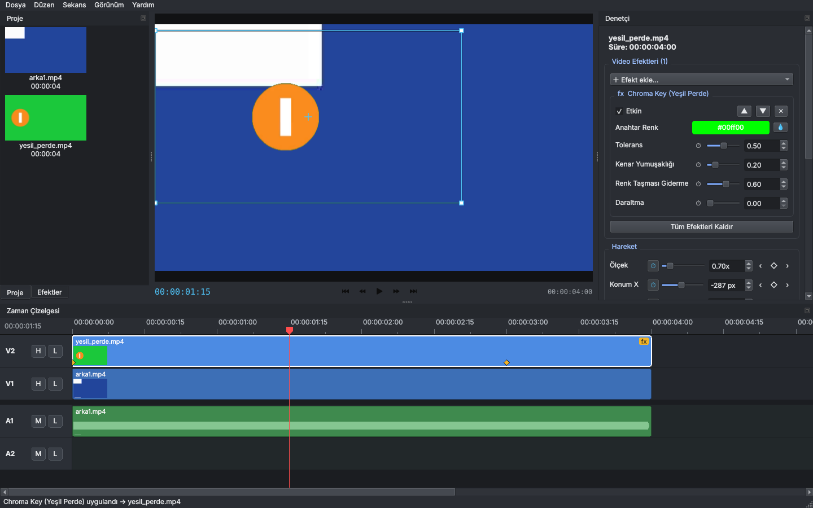

# Kurgu

**Özgür, açık kaynak ve platformlar arası video düzenleyici.**
*Free, open-source, cross-platform video editor.* Windows · macOS · Linux



"Kurgu", Türkçede film montajının adıdır. Amacımız, herkesin para ödemeden ve
hesap açmadan kullanabileceği, Python bilen herkesin katkı verebileceği,
profesyonel iş akışına sahip bir video editörü yapmak.

## Hızlı başlangıç

Gereken tek şey **Python 3.10 veya üstü** ([python.org](https://www.python.org/downloads/)).
FFmpeg'i ayrıca kurmanıza gerek yok; PyAV kendi içinde getirir.

| Sistem | Çalıştırma |
|---|---|
| Windows | `baslat.bat` dosyasına çift tıklayın |
| macOS / Linux | Terminalde `./baslat.sh` |

İlk açılışta gerekli paketler `.venv` klasörüne kurulur (birkaç dakika sürer),
sonraki açılışlar anında olur.

Elle kurmak isterseniz:

```bash
python -m venv .venv
.venv/bin/pip install -e .        # Windows: .venv\Scripts\pip install -e .
kurgu                              # veya: python -m kurgu
```

## Özellikler (v0.4)

- **Medya kutusu:** video, ses ve görsel içe aktarma, küçük önizlemeler, sürükle-bırak
- **Çok izli zaman çizelgesi:** sınırsız video ve ses izi, iz gizle/sessize al/kilitle
- **Düzenleme:** taşıma, kenardan kırpma, jilet aracı, oynatma kafasında bölme,
  silme, boşluğu kapatarak silme (ripple), çoğaltma, mıknatıs (snapping), işaretçiler
- **Bağlı klipler:** videonun görüntüsü ve sesi birlikte hareket eder, istenirse ayrılır
- **Sınırsız geri al / yinele**
- **Program monitörü:** sesli gerçek zamanlı oynatma, J/K/L ile hızlı ileri/geri
- **Efektler:** ölçek, konum, döndürme, opaklık, hız (0.1x – 16x)
- **Renk:** parlaklık, kontrast, doygunluk
- **Ses:** klip başına ses düzeyi, dalga formu görünümü
- **Anahtar kare animasyonu (keyframe):** konum, ölçek, döndürme, opaklık, renk,
  ses düzeyi ve **tüm efekt parametreleri** zamanla değişebilir.
  Denetçide ⏱ kronometreyi aç → oynatma kafasını taşı → değeri değiştir: anahtar kare
  otomatik oluşur. ‹ ◆ › ile anahtarlar arasında gez, ekle/sil.
  Zaman çizelgesinde ◆ işaretlerini sürükle; sağ tıkla **Doğrusal / Yumuşak (Ease) /
  Sabit (Hold)** geçiş seç. Anahtarlar kaynağa bağlıdır: klibi bölsen de kırpsan da
  animasyon doğru yerde kalır
- **Akıcı önizleme (Premiere'deki render mantığı):**
  - Cetvelin altındaki çubuk: **kırmızı** = efektli/geçişli, henüz render edilmemiş;
    **yeşil** = hazır. **Enter** (Sekans → Efektleri Render Et) ile kırmızı bölümler
    önceden hesaplanır, sonra takılmadan oynar
  - Oynatırken arka planda önümüzdeki 2 saniye hazırlanır
  - **Oynatma çözünürlüğü** (monitörün sağ altında): Tam / 1/2 / 1/4. Durunca her zaman
    tam çözünürlükte netleşir
  - Bir klibi düzenleyince yalnızca o klibin göründüğü kareler yeniden hesaplanır
  - Önbellek varsayılan 1 GB bellek kullanır (`KURGU_CACHE_MB` ile değiştirilebilir)
- **Mıknatıslı jilet:** jilet aracı başka izdeki kenarlara yaklaşınca yapışır, sarı kılavuz
  çizgi hizayı gösterir
- **Program monitöründe doğrudan düzenleme:** seçili klibi fareyle sürükleyerek taşı,
  köşelerinden çekerek ölçekle (kronometre açıksa anahtar kare oluşur)
- **Efektler paneli (Premiere gibi):** arama, kategoriler, klibin üzerine sürükle-bırak
  veya çift tıkla uygula; efektler sıralanabilir, açılıp kapatılabilir
- **Anahtarlama:** Chroma Key (yeşil/mavi perde) damlalıkla renk seçme, tolerans,
  kenar yumuşaklığı, renk taşması giderme, daraltma; Luma Key
- **Video efektleri:** Gauss bulanıklığı, keskinleştirme, siyah beyaz, sepya, ters çevirme,
  ton kaydırma, sıcaklık/renk tonu, seviyeler/gama, renk kaplaması, posterleştirme,
  vinyet, mozaik, film greni, kırpma, yatay/dikey çevirme
- **Video geçişleri (16):** çapraz çözülme, siyaha/beyaza geçiş, 4 yönde silme, ahır kapısı,
  saat silmesi, sola/sağa itme, sola/sağa kaydırma, yuvarlak/kutu iris, çapraz yakınlaştırma.
  Kesmenin ortasına yerleşir, ses otomatik sabit güçlü crossfade yapar
- **Geçiş düzenleme:** zaman çizelgesinde geçişe tıkla → türünü ve süresini değiştir,
  kenarından sürükleyerek uzat/kısalt, Delete ile sil
- **Efekt denetimleri:** denetçinin en üstünde; her efektin ayarı, aç/kapa, sırala, sil.
  Klipteki sarı **fx** rozetine tıklayınca doğrudan efektlere gider
- **Hata günlüğü:** beklenmeyen hatalar `~/.kurgu/kurgu.log` dosyasına yazılır
- **Kararma:** giriş/çıkış kararması (görüntü ve ses)
- **Kopyala / kes / yapıştır** ve **özellikleri yapıştır** (efekt, renk, hareket aktarımı)
- **Başlıklar:** çok satırlı, renkli, kenarlıklı metin
- **Proje ayarları:** 4K, 1080p, 720p, dikey 9:16 (Reels/Shorts), kare 1:1, istenen kare hızı
- **Dışa aktarma:** MP4 (H.264 + AAC), çözünürlük ve kalite seçimi, arka planda ilerleme çubuğu
- **Proje dosyası:** okunabilir JSON (`.kurgu`), klasör taşınsa da medyayı bulur
- **Arayüz dili:** sistem diline göre Türkçe veya İngilizce

## Klavye kısayolları

| Tuş | İşlev |
|---|---|
| Boşluk | Oynat / duraklat |
| J / K / L | Geri sar / dur / ileri sar (tekrar basınca hızlanır) |
| ← / → | Bir kare geri / ileri (Shift ile 10 kare) |
| ↑ / ↓ | Önceki / sonraki kesme noktası |
| V / C | Seçim aracı / jilet aracı |
| Ctrl+K | Oynatma kafasında böl |
| Delete / Shift+Delete | Sil / boşluğu kapatarak sil |
| Boşluğa tıkla + Delete | İki klip arasındaki boşluğu sil, sonraki klipler sola kayar |
| Ctrl+D | Varsayılan geçişi uygula (çapraz çözülme) |
| Ctrl+C / Ctrl+X / Ctrl+V | Kopyala / kes / yapıştır |
| Ctrl+Alt+V | Özellikleri yapıştır |
| Ctrl+Shift+D | Çoğalt |
| Shift+K / Ctrl+Shift+K | Sonraki / önceki anahtar kare |
| Enter | Efektli bölümleri render et |
| Ctrl+T | Başlık ekle |
| M | İşaretçi ekle |
| S | Mıknatısı aç/kapat |
| + / - / \ | Yakınlaştır / uzaklaştır / sığdır |
| Ctrl+Z / Ctrl+Shift+Z | Geri al / yinele |
| Ctrl+I / Ctrl+M | İçe aktar / dışa aktar |

Zaman çizelgesinde Ctrl + fare tekerleği yakınlaştırır.

## Komut satırı

```bash
python -m kurgu proje.kurgu                       # projeyi aç
python -m kurgu proje.kurgu --export cikti.mp4    # arayüzsüz dışa aktar
```

## Mimari

```
kurgu/
  model.py        Proje, iz, klip veri modeli + düzenleme işlemleri + geri al (Qt'den bağımsız)
  media.py        PyAV ile dosya inceleme, kare/ses çözme, önbellek, dalga formu
  keyframes.py    Anahtar kare animasyonu (enterpolasyon, düzenleme)
  effects.py      Video efektleri (yeni efekt = tek fonksiyon + @register)
  transitions.py  Video geçişleri
  rendercache.py  Render önbelleği, kare imzası, arka plan işçisi
  render.py       Katman birleştirme (QPainter), renk, ses miksajı, MP4 dışa aktarma
  i18n.py         Çeviriler
  ui/
    main_window.py  Menüler, kısayollar, proje işlemleri, dışa aktarma penceresi
    timeline.py     Zaman çizelgesi bileşeni
    player.py       Program monitörü ve ses senkronlu oynatma
    panels.py       Medya kutusu ve denetçi (efekt kontrolleri dahil)
    effects_panel.py Efektler paneli
tests/            pytest testleri (sentetik videolarla)
```

Önizleme ve dışa aktarma **aynı** `Compositor` sınıfını kullanır; ekranda ne
görüyorsanız çıktıda da onu alırsınız.

## Yol haritası

Katkılarınızı bekleyen başlıca konular:

- [x] Anahtar kare (keyframe) animasyonu
- [ ] Kaynak monitörü ve giriş/çıkış noktalarıyla (I/O) ekleme
- [x] Klipler arası geçişler (16 tür)
- [x] Chroma key, luma key ve 18 video efekti
- [ ] LUT desteği, renk tekerlekleri, eğriler, vektörskop
- [ ] Maskeleme (kalem aracı ile şekil maskesi), iz matı (track matte)
- [ ] Karıştırma modları (çarp, ekran, kaplama…)
- [ ] Ses mikseri, ses efektleri, normalizasyon
- [ ] Proxy (düşük çözünürlüklü kopya) ile düzenleme
- [ ] GPU hızlandırma (OpenGL/Vulkan ile birleştirme)
- [ ] Diske kalıcı render dosyaları
- [ ] Whisper ile otomatik altyazı
- [ ] Daha fazla çıktı biçimi (ProRes, WebM, GIF)
- [ ] Hazır paketler: Windows `.exe`, macOS `.app`, Linux AppImage / Flatpak
- [ ] Yeni dil çevirileri (`kurgu/i18n.py`)

## Katkı

1. Depoyu çatallayın (fork), yeni bir dal açın.
2. `pip install -e ".[dev]"` ve `pytest` ile testlerin geçtiğini görün.
3. Değişikliğinizi yapın, mümkünse test ekleyin, pull request açın.

Hata bildirirken işletim sisteminizi, Python sürümünüzü ve sorunu yaşatan dosya
türünü yazmanız çözümü çok hızlandırır.

## Lisans

[MIT](LICENSE). Özgürce kullanın, değiştirin, dağıtın.
