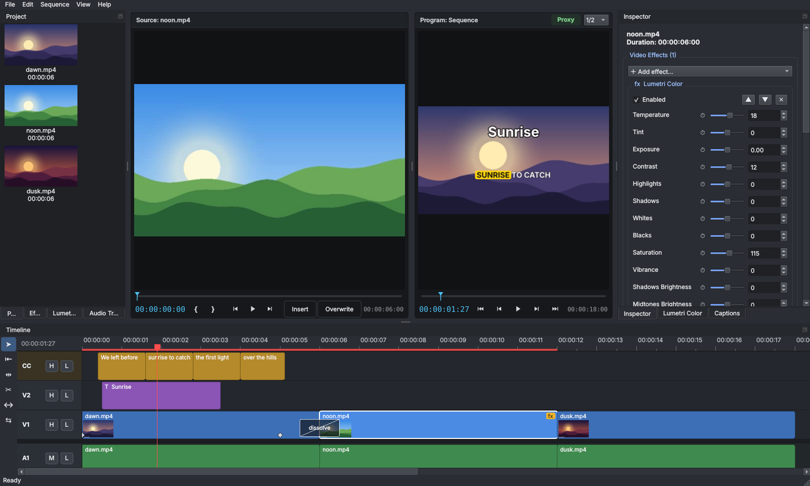
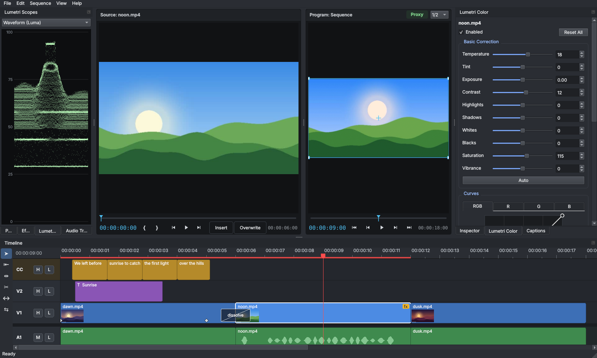
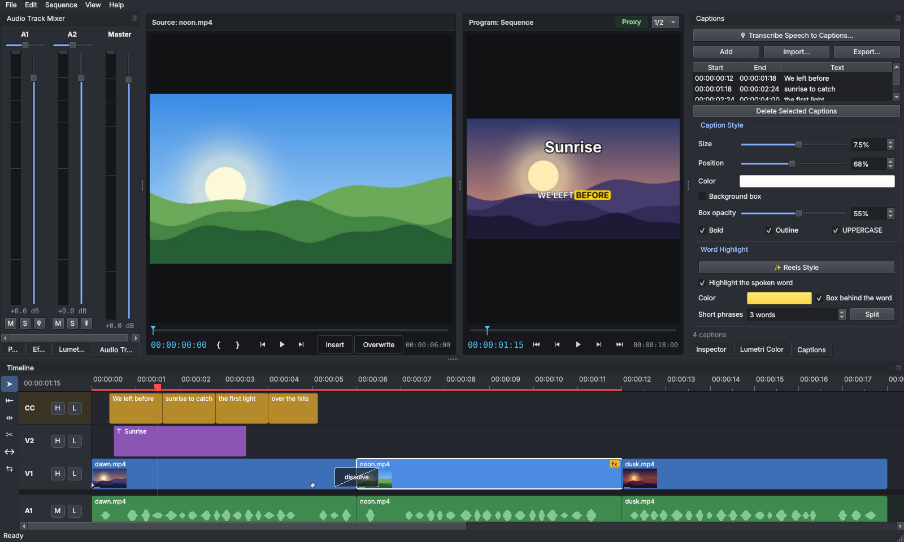

# Kurgu

**Özgür, açık kaynak ve platformlar arası video düzenleyici.**
*Free, open-source, cross-platform video editor.* Windows · macOS · Linux



| Lumetri Renk ve skoplar | Reels tarzı altyazı ve ses mikseri |
|---|---|
|  |  |

"Kurgu", Türkçede film montajının adıdır. Amacımız, herkesin para ödemeden ve
hesap açmadan kullanabileceği, Python bilen herkesin katkı verebileceği,
profesyonel iş akışına sahip bir video editörü yapmak.

## İndir ve kur

En kolay yol: GitHub'daki **[Releases](https://github.com/Batuhanuluer/Kurgu/releases)**
sayfasından işletim sisteminize uygun dosyayı indirin. Python kurmanız gerekmez.

| Sistem | Dosya | Kurulum |
|---|---|---|
| Windows | `Kurgu-…-setup.exe` | Çalıştırın, ileri ileri. `.kurgu` dosyaları çift tıklayınca açılır |
| Windows (taşınabilir) | `Kurgu-…-windows.zip` | Klasöre çıkarın, `Kurgu.exe`'ye çift tıklayın |
| macOS | `Kurgu-…-macos.dmg` | Açın, `Kurgu`'yu Uygulamalar'a sürükleyin. İmzasız sürümde ilk açılış için aşağıya bakın |
| macOS (zip) | `Kurgu-…-macos.zip` | Çıkarın, `Kurgu.app`'i Uygulamalar'a taşıyın |
| Linux (AppImage) | `Kurgu-…-x86_64.AppImage` | Tek dosya: `chmod +x Kurgu-*.AppImage` ve çalıştırın |
| Linux (tar.gz) | `Kurgu-…-linux-x86_64.tar.gz` | Çıkarın, `Kurgu/Kurgu` dosyasını çalıştırın. Ubuntu/Debian'da gerekirse: `sudo apt install libxcb-cursor0` |
| Linux (Flatpak) | `packaging/flatpak/` | `flatpak-builder --user --install build-dir packaging/flatpak/org.kurgu.Kurgu.yml` |

### macOS: "Apple could not verify Kurgu" uyarısı

Sürüm Apple Developer ID ile imzalanmadıysa macOS ilk açılışta uygulamayı engeller
(yeni sürümlerde "sağ tık → Aç" yeterli olmaz). Bir kerelik:

1. Uyarıda **Done** (Bitti) deyin, **Move to Trash** demeyin.
2. **Sistem Ayarları → Gizlilik ve Güvenlik** → en altta "Kurgu engellendi" yanında **Yine de Aç**.
3. Kurgu'yu yeniden açıp **Aç**'ı seçin.

Ya da Terminal'de: `xattr -dr com.apple.quarantine /Applications/Kurgu.app`

## Kaynaktan çalıştırma

Gereken tek şey **Python 3.10 veya üstü** ([python.org](https://www.python.org/downloads/)).
FFmpeg'i ayrıca kurmanıza gerek yok; PyAV kendi içinde getirir.

| Sistem | Çalıştırma |
|---|---|
| Windows | `baslat.bat` dosyasına çift tıklayın |
| macOS / Linux | Terminalde `./baslat.sh` |

İlk açılışta gerekli paketler `.venv` klasörüne kurulur (birkaç dakika sürer),
sonraki açılışlar anında olur.

Elle kurmak isterseniz:

```bash
python -m venv .venv
.venv/bin/pip install -e .        # Windows: .venv\Scripts\pip install -e .
kurgu                              # veya: python -m kurgu
```

### Kendi paketinizi üretmek

- **Windows:** `paketle.bat`'a çift tıklayın → `dist\Kurgu\Kurgu.exe`.
  [Inno Setup](https://jrsoftware.org/isdl.php) kuruluysa `Kurgu-…-setup.exe` kurulum programı da üretilir.
- **macOS / Linux:** `python packaging/build.py`

### Güncellemeler

Kurgu açılışta (günde en fazla bir kez) GitHub'daki son sürümü denetler; yenisi varsa
durum çubuğunda **⬆ Yeni sürüm** düğmesi çıkar. Windows'ta kurulum programıyla kurduysanız
**Şimdi Güncelle** yeni sürümü indirir, üzerine kurar ve Kurgu'yu yeniden açar; ayarlar ve
projeler korunur. Diğer sistemlerde indirme sayfası açılır. Yardım menüsünden kapatılabilir
(yalnızca herkese açık GitHub API'sine sürüm sorgusu yapılır).

Kendini güncelleme yalnızca sürüm, geliştiricinin çevrim dışı anahtarıyla **imzalanmışsa**
çalışır: indirilen kurulumun SHA-256 özeti imzalı `SHA256SUMS.txt` ile karşılaştırılır,
uyuşmazsa dosya silinir ve çalıştırılmaz. İmzasız sürümlerde indirme sayfası açılır.

### İmzalı paketler (isteğe bağlı)

GitHub deposunda **Settings → Secrets** altında şu sırlar tanımlanırsa sürüm paketleri imzalanır;
tanımlı değilse paketler imzasız üretilir:

| Sır | Ne için |
|---|---|
| `MACOS_CERT_P12`, `MACOS_CERT_PASSWORD`, `MACOS_SIGN_IDENTITY` | macOS Developer ID imzası (base64 .p12) |
| `APPLE_ID`, `APPLE_TEAM_ID`, `APPLE_APP_PASSWORD` | Apple noter onayı (notarization) |
| `WINDOWS_CERT_PFX`, `WINDOWS_CERT_PASSWORD` | Windows Authenticode imzası (base64 .pfx) |

### Yeni sürüm yayınlamak (geliştiriciler için)

```bash
git tag v0.7.2
git push --tags
```

GitHub Actions üç işletim sisteminde testleri çalıştırır, paketleri derler ve
Releases sayfasına yükler (`.github/workflows/release.yml`). Paketler sabit sürümlü
bağımlılıklarla (`packaging/requirements-release.txt`) derlenir.

**Sürümü imzalamak** (Windows'ta otomatik güncelleme için gerekli):

```bash
pip install cryptography
python packaging/make_signing_key.py      # yalnızca bir kez: anahtar üretir
# çıktıdaki PUBLIC_KEYS satırını kurgu/updater.py'ye yapıştır, commit et
python packaging/sign_release.py v0.8.1   # her sürümden sonra (GitHub CLI "gh" gerekir)
```

Gizli anahtar `~/.kurgu-signing/` klasöründe kalır; depoya ya da GitHub'a yüklenmez.
Ayrıntılar: [SECURITY.md](SECURITY.md).

## Özellikler (v0.10)

**v0.10'da yeni:** iç içe sekanslar, maske yolu ve renk tekerleği anahtar kareleri,
seslendirme kaydı, Reels tarzı kelime vurgulu altyazı, monitörde tıkla-sürükle (başlık ve
altyazı), uygulama içi dil seçimi ve İspanyolca arayüz.


- **Medya kutusu:** video, ses ve görsel içe aktarma, küçük önizlemeler, sürükle-bırak
- **Çok izli zaman çizelgesi:** sınırsız video ve ses izi, iz gizle/sessize al/kilitle
- **Düzenleme:** taşıma, kenardan kırpma, jilet aracı, oynatma kafasında bölme,
  silme, boşluğu kapatarak silme (ripple), çoğaltma, mıknatıs (snapping), işaretçiler
- **Kaynak monitörü:** medyaya çift tıkla, izle, I/O ile parçasını işaretle; Ekle (`,`) sonrakileri
  iterek araya koyar, Üzerine Yaz (`.`) yerine yazar; görüntüyü sürükleyip zaman çizelgesine bırak
- **Profesyonel kesme araçları:** Ripple (B), Roll (N), Slip (Y), Slide (U); bağlı ses/görüntü
  birlikte düzenlenir, kesme karesi program monitöründe görünür
- **Lumetri Renk (Shift+6):** sıcaklık/ton, pozlama, kontrast, parlak alanlar/gölgeler,
  beyazlar/siyahlar, doygunluk, canlılık, **Otomatik** düzeltme; RGB / R / G / B **eğrileri**;
  gölge / orta ton / parlak alan **renk tekerlekleri** (her biri ⏱ ile anahtar karelenebilir).
  Hızlı: 720p karede 13–27 ms
- **Lumetri Skopları (Shift+7):** dalga formu (luma), RGB parade, vektörskop (hedefler ve cilt
  tonu çizgisi), histogram. *Görünüm → Renk Çalışma Alanı* ikisini birlikte açar
- **Çoklu kamera:** Proje panelinde kameraları seç → sağ tık → *Çoklu Kamera Kaynak Sekansı
  Oluştur*. Kameralar **sesten otomatik eşitlenir** (çapraz korelasyon, ms altı doğruluk).
  Oynatırken **1–9** ile kameraya kes; *Görünüm → Çoklu Kamera Görünümü* (Shift+0) tüm açıları
  ızgarada gösterir, tıklayınca keser. Görüntüsü olmayan açı siyah görünür
- **Otomatik altyazı (Whisper):** *Altyazılar* paneli → Konuşmadan Altyazı Oluştur; Türkçe dahil
  12 dil + otomatik algılama, kelime zamanlarına göre dengeli 2 satır. SRT/VTT içe ve dışa
  aktarma, listeden düzenleme, iz bazında stil (boyut, konum, renk, kutu, kontur). Model ilk
  kullanımda indirilir (`~/.kurgu/models`), sonrası internetsiz çalışır
- **Reels / TikTok tarzı altyazı:** *Altyazılar → Kelime Vurgusu → ✨ Reels Stili*: büyük, ortalı,
  BÜYÜK HARF, 1–8 kelimelik kısa öbekler; konuşulan kelime renklenir ya da renkli kutuya girer.
  Kelime zamanları konuşma tanımadan gelir, metni elle değiştirsen de vurgu çalışır.
  Altyazıyı program monitöründe tutup istediğin yere sürükleyebilirsin
- **Maskeler:** elips, dikdörtgen ve **kalem** (serbest çokgen); yumuşatma, genişletme, opaklık,
  ters, ekle/çıkar/kesişim. Program monitöründe sürükleyerek düzenlenir, klip taşınınca maske de
  onunla gider. **Maske yolu anahtar karesi:** ⏱ aç, oynatma kafasını taşı, maskeyi yeniden
  şekillendir: maske kareler arasında yumuşakça kayar (elle nesne takibi). Yumuşatma, genişletme
  ve maske opaklığı da canlandırılabilir
- **Karıştırma modları (13):** çarp, ekran, kaplama, koyulaştır, açıklaştır, renk soldurma/yanması,
  sert/yumuşak ışık, fark, dışlama, ekle. **İz matı:** başka bir izin alfa ya da parlaklığıyla kes
- **Ses İzi Mikseri (Shift+9):** iz başına seviye göstergesi, fader, pan, sessiz/solo, ana çıkış
- **Ses efektleri:** ekolayzer (alçak kesme, bas, orta, varlık, tiz), kompresör, gürültü kapısı,
  uğultu giderici (50/60 Hz ve harmonikleri), de-esser. Parça parça işlemede kesintisiz
- **Ses yüksekliğini eşitle:** BS.1770 LUFS ölçümüyle YouTube -14, podcast -16, TV -23 LUFS ya da
  tepe -1 dBFS
- **İç içe sekanslar (Nest):** klipleri seç → *Sekans → İç İçe Sekans Yap…* ya da sağ tık.
  Tek klip gibi taşınır, kırpılır, efekt ve maske alır; çift tıklayınca içine girilir (üstte
  "Ana › Sahne 1" yolu, Ctrl+Backspace ile geri). İçeride yapılan değişiklikler dışarıya yansır
  ve dışarıda tek geri alma adımıdır. İç içe sekans içinde iç içe sekans da olur;
  sağ tık → *Çöz* ile klipler geri açılır
- **Seslendirme kaydı (Shift+R):** *Sekans → Seslendirme Kaydet…* ya da mikserde izin 🎙
  düğmesi. 3 saniye geri sayım, oynatma kafasından itibaren video oynarken mikrofon kaydı,
  seviye göstergesi; durdurunca WAV proje dosyasının yanındaki `Voiceover/` klasörüne yazılır
  ve klip kaydın başladığı yere yerleşir. Yankı olmasın diye kayıtta zaman çizelgesi sesi kapalı
- **Bağlı klipler:** videonun görüntüsü ve sesi birlikte hareket eder, istenirse ayrılır
- **Sınırsız geri al / yinele**
- **Program monitörü:** sesli gerçek zamanlı oynatma, J/K/L ile hızlı ileri/geri
- **Efektler:** ölçek, konum, döndürme, opaklık, hız (0.1x – 16x)
- **Renk:** parlaklık, kontrast, doygunluk
- **Ses:** klip başına ses düzeyi, dalga formu görünümü
- **Anahtar kare animasyonu (keyframe):** konum, ölçek, döndürme, opaklık, renk,
  ses düzeyi ve **tüm efekt parametreleri** zamanla değişebilir.
  Denetçide ⏱ kronometreyi aç → oynatma kafasını taşı → değeri değiştir: anahtar kare
  otomatik oluşur. ‹ ◆ › ile anahtarlar arasında gez, ekle/sil.
  Zaman çizelgesinde ◆ işaretlerini sürükle; sağ tıkla **Doğrusal / Yumuşak (Ease) /
  Sabit (Hold)** geçiş seç. Anahtarlar kaynağa bağlıdır: klibi bölsen de kırpsan da
  animasyon doğru yerde kalır
- **Proxy düzenleme:** 4K, H.265/HEVC, ProRes ya da 10-bit (D-Log) videolar içe aktarılınca
  arka planda hafif bir çalışma kopyası (540p, hızlı atlanan H.264) otomatik oluşturulur;
  önizleme onu, **dışa aktarma her zaman orijinali** kullanır. Monitördeki **Proxy** düğmesiyle
  aç/kapa; Proje panelinde ✓P işareti. 10-bit kaynakların proxy'si de 10-bit kalır.
  Örnek ölçüm: 4K 10-bit HEVC'de oynatma 8 → 28 kare/sn. Proxy'ler: `~/.kurgu/proxies/`
- **Klip uyuşmazlığı (Premiere gibi):** boş projeye ilk klip konunca boyutu farklıysa
  "proje ayarlarını klibe uydur" diye sorulur (dikey telefon videosu → dikey 9:16 proje).
  Klibe sağ tık: **Kareyi Doldur** (boşluksuz) / **Kareye Sığdır** / **Projeyi Bu Klibe Uydur**
- **Telefon videoları:** dikey çekimler (dönme bilgisi) doğru yönde gösterilir; değişken kare
  hızlı (VFR) videolarda her an doğru kare seçilir
- **Akıcı önizleme (Premiere'deki render mantığı):**
  - Cetvelin altındaki çubuk: **kırmızı** = efektli/geçişli, henüz render edilmemiş;
    **yeşil** = hazır. **Enter** (Sekans → Efektleri Render Et) ile kırmızı bölümler
    önceden hesaplanır, sonra takılmadan oynar
  - Oynatırken arka planda önümüzdeki 2 saniye hazırlanır
  - **Oynatma çözünürlüğü** (monitörün sağ altında): Tam / 1/2 / 1/4. Durunca her zaman
    tam çözünürlükte netleşir
  - Bir klibi düzenleyince yalnızca o klibin göründüğü kareler yeniden hesaplanır
  - Önbellek varsayılan 1 GB bellek kullanır; **render dosyaları diske de yazılır**
    (`~/.kurgu/render`, varsayılan 10 GB): program yeniden açılınca tekrar render gerekmez.
    *Düzen → Tercihler* (Ctrl+,) ile ayarlanır
  - **GPU ile çözme:** NVIDIA, Intel, AMD ve Apple donanım çözücüleri otomatik kullanılır
    (yoksa CPU'ya döner); dışa aktarmada **GPU kodlayıcı** (NVENC, QSV, AMF, VideoToolbox)
- **Mıknatıs ve hassas taşıma:** klipler taşınırken ve kırpılırken komşu kenarlara yapışır
  (sarı kılavuz çizgi). Komşunun üzerine *biraz* kaydırırsan kenarına dayanır; daha da
  bastırırsan klip kenardan sıçramadan, akıcı biçimde içeri girer (bilerek bindirmek için).
  Sürüklerken **Alt** (ya da Ctrl) basılı tut: mıknatıs kapanır, kare kare hassas taşırsın.
  **Alt+←/→** seçili klibi 1 kare, **Alt+Shift+←/→** 5 kare kaydırır. Sürüklerken klibin
  üstünde ne kadar kaydırdığın görünür (ör. +00:00:00:05). S tuşu mıknatısı açar/kapatır
- **Mıknatıslı jilet:** jilet aracı başka izdeki kenarlara yaklaşınca yapışır, sarı kılavuz
  çizgi hizayı gösterir
- **Program monitöründe doğrudan düzenleme:** görüntüde bir başlığa, videoya ya da altyazıya
  tıkla, seçilir; sürükleyerek taşı, köşelerinden çekerek ölçekle (kronometre açıksa anahtar
  kare oluşur). Altyazılar ortaya yaklaşınca ortaya yapışır
- **Renk eşleştirme (Premiere Lumetri "Color Match" gibi):** Pinterest'ten ya da bir filmden
  aldığın bir kareyi Proje paneline bırak → sağ tık **Renk Referansı Olarak Kullan** → kliplerini
  seç → sağ tık **Renk Paletini Uygula**. Görselin renk dağılımı (ortalama + renkler arası ilişki)
  klibe aktarılır; denetçide referansın paleti, miktar ve "parlaklığı da eşle" seçeneği görünür.
  Zaman çizelgesindeki bir klipten de referans alınabilir
- **LUT (.cube) desteği:** ör. DJI'ın resmî D-Log → Rec.709 LUT'u ya da sinema görünümleri.
  **D-Log için önerilen sıra:** önce LUT, sonra Renk Eşleştirme (eşleştirme LUT'lu görüntüye göre
  ölçülür; LUT değişince otomatik yeniden ölçülür)
- **10-bit görüntü desteği:** D-Log gibi 10-bit videolarda renk işlemi varken görüntü yüksek bit
  derinliğinde okunur ve dither'la 8-bit'e indirilir: kontrast açılınca gökyüzünde bantlanma olmaz
- **Efektler paneli (Premiere gibi):** arama, kategoriler, klibin üzerine sürükle-bırak
  veya çift tıkla uygula; efektler sıralanabilir, açılıp kapatılabilir
- **Anahtarlama:** Chroma Key (yeşil/mavi perde) damlalıkla renk seçme, tolerans,
  kenar yumuşaklığı, renk taşması giderme, daraltma; Luma Key
- **Video efektleri:** Gauss bulanıklığı, keskinleştirme, siyah beyaz, sepya, ters çevirme,
  ton kaydırma, sıcaklık/renk tonu, seviyeler/gama, renk kaplaması, posterleştirme,
  vinyet, mozaik, film greni, kırpma, yatay/dikey çevirme
- **Video geçişleri (16):** çapraz çözülme, siyaha/beyaza geçiş, 4 yönde silme, ahır kapısı,
  saat silmesi, sola/sağa itme, sola/sağa kaydırma, yuvarlak/kutu iris, çapraz yakınlaştırma.
  Kesmenin ortasına yerleşir, ses otomatik sabit güçlü crossfade yapar
- **Geçiş düzenleme:** zaman çizelgesinde geçişe tıkla → türünü ve süresini değiştir,
  kenarından sürükleyerek uzat/kısalt, Delete ile sil
- **Efekt denetimleri:** denetçinin en üstünde; her efektin ayarı, aç/kapa, sırala, sil.
  Klipteki sarı **fx** rozetine tıklayınca doğrudan efektlere gider
- **Otomatik kaydetme ve çökme kurtarma:** proje her 2 dakikada bir yedeklenir
  (Dosya → Otomatik Kaydetme: kapalı / 1 / 2 / 5 / 10 dk; proje başına son 5 yedek).
  Program beklenmedik şekilde kapanırsa bir sonraki açılışta son yedek önerilir.
  Bir hata anında da hemen acil yedek alınır. Yedekler: `~/.kurgu/autosave/`
- **Hata günlüğü:** beklenmeyen hatalar `~/.kurgu/kurgu.log` dosyasına yazılır
- **Kararma:** giriş/çıkış kararması (görüntü ve ses)
- **Kopyala / kes / yapıştır** ve **özellikleri yapıştır** (efekt, renk, hareket aktarımı)
- **Başlıklar:** çok satırlı, renkli, kenarlıklı metin
- **Proje ayarları:** 4K, 1080p, 720p, dikey 9:16 (Reels/Shorts), kare 1:1, istenen kare hızı
- **Dışa aktarma (Ctrl+M):** hazır ayarlar (YouTube 1080p/4K, Reels/TikTok/Shorts 9:16,
  Instagram 1:1, X, ProRes ana kopya, WebM, GIF, MP3/WAV); biçimler H.264, H.265, **H.265 10-bit**,
  **ProRes 422 HQ (10-bit)**, VP9, AV1, GIF, MP3, WAV. 10-bit biçimlerde kareler 16 bit/kanal
  işlenir (bantlanmasız). Zaman çizelgesinde **I / O** ile aralık işaretleyip yalnız onu dışa aktar.
  Farklı en-boy oranında siyah kenar eklenir. **Kareyi Dışa Aktar** (Ctrl+Shift+E): PNG/JPEG
- **Proje dosyası:** okunabilir JSON (`.kurgu`), klasör taşınsa da medyayı bulur
- **Arayüz dili:** Türkçe, English, Español. *Düzen → Tercihler → Arayüz dili* ile seçilir
  (varsayılan: sistem dili). Yeni dil eklemek için [CONTRIBUTING.md](CONTRIBUTING.md)
- **Sorun bildir:** *Yardım → Sorun Bildir…* sistem bilgisini ekler, kişisel klasör adlarını
  gizler ve GitHub'da hazır doldurulmuş bir kayıt açar; hiçbir şey otomatik gönderilmez

## Klavye kısayolları

| Tuş | İşlev |
|---|---|
| Boşluk | Oynat / duraklat (kaynak monitörü odaktaysa onu oynatır) |
| J / K / L | Geri sar / dur / ileri sar (tekrar basınca hızlanır) |
| ← / → | Bir kare geri / ileri (Shift ile 10 kare) |
| ↑ / ↓ | Önceki / sonraki kesme noktası |
| V / C | Seçim aracı / jilet aracı |
| B / N | Ripple aracı (kenarı çek, sonrakiler takip etsin) / Roll aracı (kesmeyi kaydır) |
| Y / U | Slip aracı (kaynağı kaydır) / Slide aracı (klibi komşuları arasında kaydır) |
| I / O | Giriş / çıkış işaretle (kaynak monitörü odaktaysa kaynakta, değilse sekansta) |
| Ctrl+Shift+X | Giriş/çıkış işaretlerini temizle |
| 1 – 9 | Çoklu kamera: o kameraya kes (oynatırken de) |
| Shift+0 | Çoklu kamera görünümü |
| Shift+6 / Shift+7 / Shift+9 | Lumetri Renk / Lumetri Skopları / Ses İzi Mikseri |
| Ctrl+Shift+E | Kareyi dışa aktar |
| Ctrl+, | Tercihler |
| Shift+R | Seslendirme kaydı |
| Ctrl+Backspace | İç içe sekanstan üst sekansa dön |
| Esc | Kalem maskesini iptal et |
| , / . | Kaynaktan ekle / üzerine yaz (oynatma kafasına) |
| Ctrl+K | Oynatma kafasında böl |
| Delete / Shift+Delete | Sil / boşluğu kapatarak sil |
| Boşluğa tıkla + Delete | İki klip arasındaki boşluğu sil, sonraki klipler sola kayar |
| Ctrl+D | Varsayılan geçişi uygula (çapraz çözülme) |
| Ctrl+C / Ctrl+X / Ctrl+V | Kopyala / kes / yapıştır |
| Ctrl+Alt+V | Özellikleri yapıştır |
| Ctrl+Shift+D | Çoğalt |
| Shift+K / Ctrl+Shift+K | Sonraki / önceki anahtar kare |
| Alt+← / Alt+→ | Seçili klibi 1 kare kaydır (Shift ile 5 kare) |
| Sürüklerken Alt | Hassas taşıma (mıknatıs yok) |
| Enter | Efektli bölümleri render et |
| Ctrl+T | Başlık ekle |
| M | İşaretçi ekle |
| S | Mıknatısı aç/kapat |
| + / - / \ | Yakınlaştır / uzaklaştır / sığdır |
| Ctrl+Z / Ctrl+Shift+Z | Geri al / yinele |
| Ctrl+I / Ctrl+M | İçe aktar / dışa aktar |

Zaman çizelgesinde Ctrl + fare tekerleği yakınlaştırır.

## Komut satırı

```bash
python -m kurgu proje.kurgu                       # projeyi aç
python -m kurgu proje.kurgu --export cikti.mp4    # arayüzsüz dışa aktar
```

## Mimari

```
kurgu/
  model.py        Proje, iz, klip veri modeli + düzenleme işlemleri + geri al (Qt'den bağımsız)
  media.py        PyAV ile dosya inceleme, kare/ses çözme, önbellek, dalga formu
  keyframes.py    Anahtar kare animasyonu (enterpolasyon, düzenleme)
  colormatch.py   Renk eşleştirme (doğrusal Monge-Kantorovich aktarımı) ve palet çıkarma
  effects.py      Video efektleri (yeni efekt = tek fonksiyon + @register)
  transitions.py  Video geçişleri
  proxy.py        Proxy üretimi (ağır videoların hafif kopyaları)
  rendercache.py  Render önbelleği (bellek + kalıcı disk), kare imzası, arka plan işçisi
  render.py       Katman birleştirme (QPainter, 8/16 bit), maske/mat, ses miksajı
  grading.py      Lumetri renk düzeltme (ton tablosu, eğriler, tekerlekler, 16 bit yol)
  masks.py        Maskeler, karıştırma modları, iz matı
  multicam.py     Çoklu kamera: sesten eşitleme (FFT çapraz korelasyon)
  captions.py     Altyazılar: SRT/VTT, satır bölme, kelime vurgusu, Whisper ile konuşma tanıma
  recorder.py     Seslendirme kaydı (mikrofon → WAV)
  audio.py        Ses efektleri (FIR EQ, dinamikler), pan, LUFS ölçümü
  exporter.py     Dışa aktarma biçimleri, hazır ayarlar, 10-bit, GIF paleti
  hw.py           Donanım (GPU) ile çözme ve kodlama
  updater.py      Güncelleme denetimi ve Windows'ta kendini güncelleme
  autosave.py     Otomatik kaydetme, oturum kilidi, çökme kurtarma
  i18n.py         Çeviri sistemi ve Türkçe; locales/ diğer diller (es.py…)
  ui/
    main_window.py  Menüler, kısayollar, proje işlemleri, dışa aktarma penceresi
    timeline.py     Zaman çizelgesi bileşeni
    player.py       Program monitörü ve ses senkronlu oynatma
    source.py       Kaynak monitörü (I/O, Ekle / Üzerine Yaz, çoklu kamera ızgarası)
    color_panel.py  Lumetri Renk paneli (tekerlekler, eğri düzenleyici)
    scopes.py       Skoplar
    mask_panel.py   Opaklık ve Maskeler bölümü
    mixer.py        Ses izi mikseri ve klip ses efektleri
    captions_panel.py Altyazılar paneli
    voiceover.py    Seslendirme kaydı penceresi
    panels.py       Medya kutusu ve denetçi (efekt kontrolleri dahil)
    effects_panel.py Efektler paneli
tests/            pytest testleri (sentetik videolarla)
packaging/        PyInstaller paketleme, AppImage, macOS dmg/imza, Inno Setup, Flatpak
```

Önizleme ve dışa aktarma **aynı** `Compositor` sınıfını kullanır; ekranda ne
görüyorsanız çıktıda da onu alırsınız.

## Yol haritası

Katkılarınızı bekleyen başlıca konular:

- [x] Anahtar kare (keyframe) animasyonu
- [x] Kaynak monitörü ve giriş/çıkış noktalarıyla (I/O) ekleme
- [x] Ripple / Roll / Slip / Slide araçları
- [x] Klipler arası geçişler (16 tür)
- [x] Chroma key, luma key ve 18 video efekti
- [x] LUT (.cube) desteği ve renk eşleştirme
- [x] Lumetri renk: tekerlekler, eğriler; dalga formu, vektörskop, histogram
- [x] Çoklu kamera (sesten eşitleme)
- [x] Whisper ile otomatik altyazı, SRT/VTT
- [x] 10-bit işleme ve 10-bit (HEVC/ProRes) dışa aktarma, hazır ayarlar, WebM, AV1, GIF
- [x] Maskeleme (kalem dahil), iz matı, karıştırma modları
- [x] Ses mikseri, ses efektleri, LUFS normalizasyonu
- [x] Proxy (düşük çözünürlüklü kopya) ile düzenleme
- [x] Diske kalıcı render dosyaları, GPU ile çözme ve kodlama
- [x] Hazır paketler: Windows kurulum + zip, macOS dmg/zip, Linux AppImage/tar.gz, Flatpak manifesti
- [ ] GPU ile katman birleştirme (OpenGL/Vulkan)
- [x] Maske yolu ve renk tekerleklerinde anahtar kare
- [x] Seslendirme kaydı
- [x] Kelime kelime vurgulu altyazı (Reels tarzı)
- [x] İç içe sekanslar (nested sequence)
- [x] Uygulama içi dil seçimi, İspanyolca arayüz
- [ ] Ses geçişleri kütüphanesi, altyazı stil şablonları
- [ ] Otomatik nesne takibi (maske izleme)
- [ ] Yeni dil çevirileri: Almanca, Fransızca, Arapça… ([nasıl?](CONTRIBUTING.md#translations))

## Katkı

Her türlü katkıya açığız: hata düzeltme, yeni efekt, çeviri, belge. Ayrıntılar
**[CONTRIBUTING.md](CONTRIBUTING.md)** dosyasında (Türkçe özet en altta).

1. Depoyu çatallayın (fork), yeni bir dal açın.
2. `pip install -e ".[dev]"` ve `pytest -q` ile testlerin geçtiğini görün.
3. Değişikliğinizi yapın, mümkünse test ekleyin, pull request açın.

Hata bildirmenin en kolay yolu uygulamada **Yardım → Sorun Bildir…**. README'deki ekran
görüntüleri `python packaging/screenshots.py` ile yeniden üretilir.

## Lisans

[MIT](LICENSE). Özgürce kullanın, değiştirin, dağıtın.
